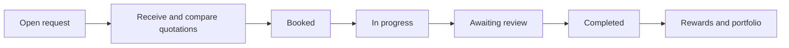
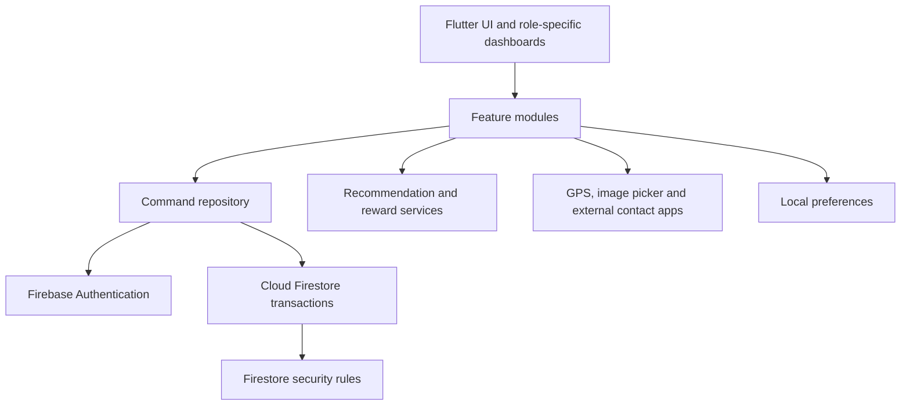

# Servora

**Trusted services, simplified.**

An intelligent multi-service marketplace connecting customers with local service professionals through transparent quotations, personalized recommendations and performance-based rewards.


**NSBM Green University · SE303.3 Mobile Application Development · Group 50**

> **Repository status:** This README describes the team's locally tested Android application. The completed modular Flutter source, Android runner and automated tests are pending integration into this repository. The current repository contains an earlier starter implementation; its dependencies and setup differ from the tested version. Do not treat the test results below as CI results for this branch.

## Overview

Finding a reliable service provider can be difficult when prices, experience, availability and previous customer feedback are not easily comparable. Servora brings these details together in a single mobile application, helping customers make informed decisions and enabling service providers to manage work and build their reputation.

Supported service categories include plumbing, electrical work, painting, carpentry, masonry, gardening, cleaning and mechanics.

## Key features

| Customer experience | Provider experience |
| --- | --- |
| Account registration and login | Service profile and multiple service categories |
| Service requests with budget, description and optional photo | Availability, service rates and experience |
| GPS-assisted location entry | Discover relevant service requests |
| Receive, compare and accept quotations | Submit, edit and withdraw quotations |
| Personalized provider ranking | Start assigned jobs and submit work results |
| Job progress, history and feedback | Performance rewards and earnings summaries |
| Calls and WhatsApp contact options | Portfolio of completed work with photo consent |

The application also provides role-specific dashboards, light and dark themes, account recovery, profile photos, in-app activity notifications and location/privacy controls.

## How it works

1. A customer creates a service request with a category, budget and location.
2. Eligible providers submit quotations with a price, estimated duration and note.
3. The customer compares quotations and recommendation scores, then selects one provider.
4. The assigned provider starts the job and submits a completion summary and optional result photograph.
5. The customer reviews the completed work and chooses whether to share the result photo in the provider's portfolio.
6. The provider's performance statistics, reward points, rank and service charge records are updated.



## Intelligent recommendations

Servora uses an explainable weighted scoring approach, supported by historical feedback and similarity-based rating estimates. It is not a trained machine-learning model or an external generative AI service.

The balanced strategy combines eight factors:

| Factor | Weight |
| --- | ---: |
| Budget fit | 20% |
| Predicted quality | 20% |
| Customer feedback | 15% |
| Reliability | 15% |
| Estimated completion time | 10% |
| Proximity | 10% |
| Experience | 5% |
| Provider rank | 5% |

Alternative priorities combine the balanced score (70%) with the selected factor (30%). Customers remain responsible for their final choice.

## Provider rewards

Providers receive 10 points for a reviewed completed job, with additional points for a rating of at least four stars (+5), on-time completion (+4) and a quick quotation response (+3).

| Rank | Points | Service charge |
| --- | ---: | ---: |
| Bronze | 0–49 | 10% |
| Silver | 50–119 | 8% |
| Gold | 120+ | 5% |

The charge for a completed job is calculated using the provider's applicable pre-review rank. Earnings are recorded estimates and service-charge calculations, not payment processing or actual money transfers.

## Technology stack

| Layer | Technology |
| --- | --- |
| Mobile client | Flutter, Dart, Material Design |
| Authentication | Firebase Authentication (email/password) |
| Database | Cloud Firestore |
| Data integrity | Firestore transactions and security rules |
| Device services | Geolocator, image picker and URL launcher |
| Local preferences | Shared preferences |
| Development | VS Code, Git, GitHub, Android SDK |
| Testing | Flutter test, Firebase Local Emulator Suite |

The tested implementation uses direct Firestore transactions rather than deployed Cloud Functions. Compressed images are stored as Firestore byte fields (up to 300 KiB per image). Activity notifications are generated in the app, rather than delivered as remote push notifications.

## Architecture of the tested application



Planned repository layout once the tested source is integrated:

```text
lib/
  app/             # App shell, dashboards, branding and themes
  core/            # Validation and reusable widgets
  features/        # Auth, jobs, requests, providers, settings and more
  models/          # Quotation model
  repositories/    # Firestore command repository
  services/        # Recommendation and reward calculations
  strategies/      # Recommendation strategy implementations
  main.dart
  firebase_options.dart
android/           # Android application and Gradle configuration
assets/branding/   # Icon and splash resources
test/              # Flutter unit and widget tests
firestore.rules    # Database access and transition validation
firebase.json
pubspec.yaml
pubspec.lock
```

## Getting started

### Tested modular version — after integration

Prerequisites: Flutter SDK, Git, Android SDK and a compatible JDK. The team's tested Windows Android build environment uses Java 17. Android Studio is optional if the Android command-line tools are configured correctly.

```bash
git clone https://github.com/Dhanika24/servora.git
cd servora
git switch development
flutter doctor
flutter pub get
flutter analyze
flutter test
flutter devices
flutter run
```

Use an Android phone with USB debugging enabled or a configured emulator. Use approved Firebase client configuration for the Android package and a team-approved test account. For a separate Firebase project, enable Email/Password authentication, create Firestore and configure the Android app using FlutterFire; deploy rules only with the project owner's authorization. Never share service-account private keys, signing passwords or real customer data.

### Current starter repository — before integration

The current checkout still uses an earlier Firebase Functions, Storage and Messaging design. Its original setup includes the Android runner generator (`python scripts/android_setup.py`), FlutterFire CLI and the Node.js functions package. See [design notes](docs/design.md), [development schedule](docs/ten-days.md) and [team allocation](docs/team-work-allocation.md) for the original plan. The independent browser walkthrough in `dist/` uses sample data and is not the final Android app.

Do not deploy the starter backend into the team's active Firebase project or regenerate the tested Android runner. Use the separately distributed tested source until the integration is complete.

## Build an Android APK

After the tested source is integrated and configured:

```bash
flutter build apk --release --split-per-abi
```

APK outputs are located in `build/app/outputs/flutter-apk/`. The ARM64 build is suitable for most modern Android devices. For one APK containing all supported architectures, use `flutter build apk --release`.

The team's demonstration APK is debug-signed in release mode. Dedicated release signing is required for production distribution. No APK download is linked here until a repository release is published.

## Security and testing

The tested version implements role and ownership checks, restricted access to exact job locations and private contacts, quotation validation, authorized job transitions, reward validation and consent-based sharing of result photos.

Recorded local verification (26 November 2026):

| Test suite | Passed | Failed |
| --- | ---: | ---: |
| Flutter unit and widget tests | 41 | 0 |
| Firestore emulator security and regression tests | 32 | 0 |
| **Total** | **73** | **0** |

The release APK was built successfully and physical-device functionality testing was reported complete by the team. Flutter analysis reported two informational deprecation notices and no errors or warnings. The Firestore tests were run against an isolated demo project using Java 21, not the live database. The security test harness is currently maintained separately from the app repository.

These results are local evidence, not an independently verified production security audit or automated GitHub status. Retest after integration.

## Team and collaboration

The following table describes planned module ownership, not completed or measured individual contributions.

| Member | Responsibility | Planned feature branch |
| --- | --- | --- |
| Dhanika | Architecture, Firebase, database security and integration | `feature/core-backend` |
| Hiranya | UI/UX, branding, recommendations and reward logic | `feature/recommendation-ui` |
| Chaniru | Customer requests, history and reviews | `feature/customer` |
| Kaweesha | Provider services, quotations and earnings | `feature/provider` |
| Chathurya | Location, communication and notifications | `feature/device-services` |
| Sachini | Authentication, settings and portfolio | `feature/account-portfolio` |

The starter commit is AI-assisted setup. Individual contributions should be documented accurately, with real commits, testing evidence and explanations of the work performed.

Once the common baseline is available, branch from `development`, commit meaningful changes, run the relevant tests and open a pull request into `development`. Coordinate changes to shared modules. Integrate the tested application into `main` for final submission. Avoid force pushes and never commit local credentials or generated build caches.

## Limitations and future development

- Internet connectivity is required for shared database operations.
- The current free-tier architecture has storage and operation quotas.
- Production signing, scalable image storage and broader security verification remain future work.
- Dedicated emergency dispatch, remote push notifications and online payment processing are outside the tested implementation.
- Recommendation scoring can be extended using additional validated historical data.

## Academic context

Servora is a university mobile application development project intended for demonstration and assessment. The final submission will include the report, verified individual contribution evidence, GitHub repository and evaluator-accessible source code.

**Servora — Trusted services, simplified.**
